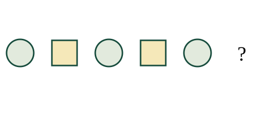
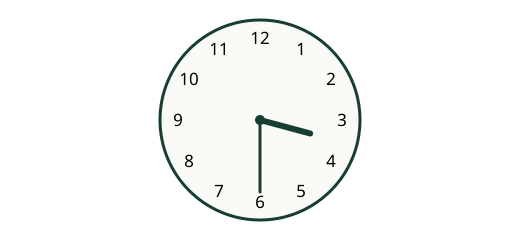
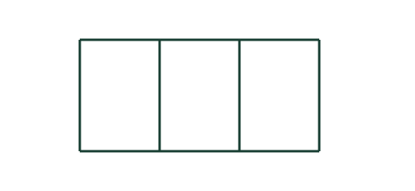

# தமிழ் வழிப் பயிற்சித் தேர்வு 1

**ஆசிரியர் சரிபார்ப்பு தேவை — அதிகாரப்பூர்வ வினாத்தாள் அல்ல.**

40 MCQs · 60 நிமிடங்கள் · ஒவ்வொரு வினாவுக்கும் 2.5 மதிப்பெண்கள் · மொத்தம் 100

1. 142 + 57 = ?

   A. 199
   B. 200
   C. 209

2. 481 − 143 = ?

   A. 338
   B. 348
   C. 328

3. 7 × 5 = ?

   A. 30
   B. 42
   C. 35

4. 50 ÷ 5 = ?

   A. 11
   B. 10
   C. 13

5. ஒரு பென்சிலின் விலை ரூ. 20. 4 பென்சில்களின் விலை எவ்வளவு?

   A. ரூ. 80
   B. ரூ. 100
   C. ரூ. 60

6. 32 மாம்பழங்களில் பாதி பழங்கள் விற்கப்பட்டன. எத்தனை பழங்கள் விற்கப்பட்டன?

   A. 30
   B. 8
   C. 16

7. 1 மீட்டர் 25 சென்டிமீட்டர் என்பது எத்தனை சென்டிமீட்டர்?

   A. 125
   B. 100
   C. 150

8. ஒரு வகுப்பு காலை 9:15 மணிக்குத் தொடங்கி 15 நிமிடங்கள் நடைபெறுகிறது. அது எப்போது முடியும்?

   A. காலை 9:30
   B. காலை 10:30
   C. காலை 9:25

9. ஒரு செவ்வகத்தின் நீளம் 8 செ.மீ., அகலம் 4 செ.மீ. அதன் சுற்றளவு என்ன?

   A. 12 செ.மீ.
   B. 30 செ.மீ.
   C. 24 செ.மீ.

10. 1147 என்ற எண்ணில் நூறுகள் இடத்திலுள்ள இலக்கம் எது?

   A. 9
   B. 0
   C. 1

11. 3, 6, 9, 12, __. அடுத்த எண் எது?

   A. 14
   B. 15
   C. 18

12. 90, 87, 84, 81, __. அடுத்த எண் எது?

   A. 79
   B. 78
   C. 75

13. 13 பேர் வரிசையில் நிற்கிறார்கள். முன்புறத்திலிருந்து கவி 4 ஆவது இடத்தில் உள்ளார். பின்புறத்திலிருந்து அவர் எத்தனையாவது?

   A. 10
   B. 11
   C. 9

14. இன்று திங்கட்கிழமை. 3 நாட்களுக்குப் பிறகு என்ன கிழமை?

   A. வியாழக்கிழமை
   B. புதன்கிழமை
   C. திங்கட்கிழமை

15. ஒரு சிவப்புப் பெட்டியில் 6 பந்துகள், நீலப் பெட்டியில் 10, பச்சைப் பெட்டியில் 16 உள்ளன. அதிக பந்துகள் உள்ள பெட்டி எது?

   A. சிவப்புப் பெட்டி
   B. பச்சைப் பெட்டி
   C. மூன்றிலும் சமம்

16. “உயரம்” என்பதன் எதிர்ச்சொல் எது?

   A. அகலம்
   B. தாழ்வு
   C. பெருமை

17. “மரம்” என்பதன் பன்மை வடிவம் எது?

   A. மரங்கள்
   B. மரத்தில்
   C. மரத்தை

18. பின்வருவனவற்றில் வினைச்சொல் எது?

   A. மாணவன்
   B. ஓடுகிறான்
   C. புத்தகம்

19. “அம்மா உணவு சமைக்கிறார்.” இவ்வாக்கியத்தில் சமைப்பவர் யார்?

   A. உணவு
   B. அம்மா
   C. மாணவன்

20. “மலர்” என்பதற்கு ஒத்த பொருள் தரும் சொல் எது?

   A. இலை
   B. பூ
   C. வேர்

21. செடியின் எந்தப் பகுதி மண்ணிலிருந்து நீரை உறிஞ்சுகிறது?

   A. பூ
   B. வேர்
   C. விதை

22. உணவு உண்பதற்கு முன் செய்ய வேண்டிய நல்ல பழக்கம் எது?

   A. சவர்க்காரத்துடன் கைகளைக் கழுவுதல்
   B. கைகளை உடையில் துடைத்தல்
   C. விளையாடிவிட்டு உடனே உண்ணுதல்

23. மழைநீரைச் சேமிக்க ஏற்ற முறை எது?

   A. சாலையில் ஓடவிடுதல்
   B. திறந்த குழியில் தேக்குதல்
   C. சுத்தமான மூடியுள்ள தொட்டியில் சேகரித்தல்

24. காற்றின் திசையைக் காட்டப் பயன்படும் கருவி எது?

   A. காற்றுத் திசைகாட்டி
   B. வெப்பமானி
   C. கடிகாரம்

25. பின்வருவனவற்றில் மீண்டும் பயன்படுத்தக்கூடிய பொருள் எது?

   A. துணிப் பை
   B. அழுக்கான காகிதத் துடைப்பான்
   C. உடைந்த கண்ணாடித் துண்டு

26. படத்தில் உள்ள உருவ வரிசையில் அடுத்து வரவேண்டிய உருவம் எது?

   A. முக்கோணம்
   B. சதுரம்
   C. வட்டம்

27. படத்தில் உள்ள கடிகாரம் காட்டும் நேரம் என்ன?

   A. 3:30
   B. 3:00
   C. 4:30

28. படத்தில் உள்ள சிறிய மற்றும் பெரிய செவ்வகங்கள் அனைத்தையும் எண்ணினால் மொத்தம் எத்தனை? சதுரங்களையும் செவ்வகங்களாக எண்ணுக.

   A. 8
   B. 6
   C. 3

29. 4 பைகளில் தலா 7 கற்கள் உள்ளன. அவற்றிலிருந்து 3 கற்களை எடுத்தால் மீதி எத்தனை?

   A. 26
   B. 25
   C. 31

30. மாலா ரூ. 300 கொடுத்து ரூ. 100 பெறுமதியான பொருள் வாங்கினார். மீதிப் பணம் எவ்வளவு?

   A. ரூ. 200
   B. ரூ. 400
   C. ரூ. 225

31. 44 மாணவர்களில் நான்கில் ஒரு பங்கினர் இசை நிகழ்ச்சியில் பங்கேற்றனர். பங்கேற்ற மாணவர்கள் எத்தனை?

   A. 15
   B. 11
   C. 22

32. ஒரு சதுரத்தின் ஒரு பக்க நீளம் 4 செ.மீ. அதன் சுற்றளவு என்ன?

   A. 20 செ.மீ.
   B. 8 செ.மீ.
   C. 16 செ.மீ.

33. ஒரு பண்ணையில் 5 கோழிகளும் 2 மாடுகளும் உள்ளன. அவற்றின் கால்கள் மொத்தம் எத்தனை?

   A. 18
   B. 28
   C. 14

34. ஒரு மணி ஒவ்வொரு 4 நிமிடங்களுக்கும் ஒலிக்கிறது. 10:00 மணிக்கு ஒலித்த பின் மூன்றாவது முறை எப்போது ஒலிக்கும்?

   A. 10:16
   B. 10:12
   C. 10:08

35. 37, 33, 39 ஆகியவற்றை ஏறுவரிசையில் அமைக்கவும்.

   A. 37, 33, 39
   B. 33, 37, 39
   C. 39, 37, 33

36. ஒரு வகுப்பில் சிவப்புப் பேனாக்கள் 15, நீலப் பேனாக்கள் 11, பச்சைப் பேனாக்கள் 9 உள்ளன. நீலத்தைவிட சிவப்புப் பேனாக்கள் எத்தனை அதிகம்?

   A. 4
   B. 6
   C. 2

37. ஒரு பாத்திரத்தில் 6 லீட்டர் நீர் இருந்தது. 3 லீட்டர் பயன்படுத்தப்பட்டது. எத்தனை மில்லிலீட்டர் மீதமுள்ளது?

   A. 300
   B. 3000
   C. 30

38. 3 வாரங்களும் 2 நாட்களும் சேர்ந்து எத்தனை நாட்கள்?

   A. 21
   B. 17
   C. 23

39. ஒரே வரிசையில் சம இடைவெளியில் 4 மரங்கள் உள்ளன. அடுத்தடுத்த மரங்களுக்கு இடையில் 3 மீட்டர் உள்ளது. முதல் மரத்திலிருந்து கடைசி மரம் வரை தூரம் என்ன?

   A. 9 மீட்டர்
   B. 15 மீட்டர்
   C. 12 மீட்டர்

40. கவி 3 மீட்டர் வடக்கே நடந்தார். பின்னர் 4 மீட்டர் கிழக்கே நடந்தார். அவர் கடைசியாக நடந்த திசை எது?

   A. வடக்கு
   B. மேற்கு
   C. கிழக்கு