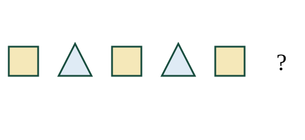
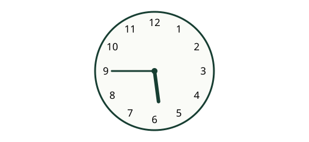
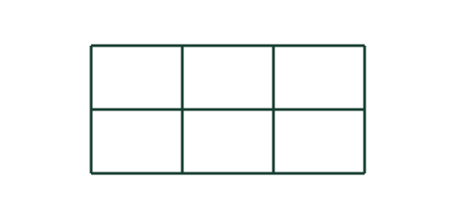

# தமிழ் வழிப் பயிற்சித் தேர்வு 3

**ஆசிரியர் சரிபார்ப்பு தேவை — அதிகாரப்பூர்வ வினாத்தாள் அல்ல.**

40 MCQs · 60 நிமிடங்கள் · ஒவ்வொரு வினாவுக்கும் 2.5 மதிப்பெண்கள் · மொத்தம் 100

1. 176 + 75 = ?

   A. 252
   B. 251
   C. 241

2. 543 − 159 = ?

   A. 394
   B. 384
   C. 484

3. 9 × 7 = ?

   A. 16
   B. 63
   C. 72

4. 84 ÷ 7 = ?

   A. 15
   B. 12
   C. 13

5. ஒரு பென்சிலின் விலை ரூ. 30. 6 பென்சில்களின் விலை எவ்வளவு?

   A. ரூ. 36
   B. ரூ. 210
   C. ரூ. 180

6. 48 மாம்பழங்களில் பாதி பழங்கள் விற்கப்பட்டன. எத்தனை பழங்கள் விற்கப்பட்டன?

   A. 28
   B. 24
   C. 46

7. 3 மீட்டர் 25 சென்டிமீட்டர் என்பது எத்தனை சென்டிமீட்டர்?

   A. 350
   B. 325
   C. 300

8. ஒரு வகுப்பு காலை 9:15 மணிக்குத் தொடங்கி 25 நிமிடங்கள் நடைபெறுகிறது. அது எப்போது முடியும்?

   A. காலை 9:40
   B. காலை 10:40
   C. காலை 9:35

9. ஒரு செவ்வகத்தின் நீளம் 10 செ.மீ., அகலம் 6 செ.மீ. அதன் சுற்றளவு என்ன?

   A. 34 செ.மீ.
   B. 16 செ.மீ.
   C. 32 செ.மீ.

10. 1347 என்ற எண்ணில் நூறுகள் இடத்திலுள்ள இலக்கம் எது?

   A. 7
   B. 9
   C. 3

11. 5, 10, 15, 20, __. அடுத்த எண் எது?

   A. 25
   B. 24
   C. 30

12. 110, 105, 100, 95, __. அடுத்த எண் எது?

   A. 89
   B. 90
   C. 91

13. 15 பேர் வரிசையில் நிற்கிறார்கள். முன்புறத்திலிருந்து கவி 6 ஆவது இடத்தில் உள்ளார். பின்புறத்திலிருந்து அவர் எத்தனையாவது?

   A. 6
   B. 10
   C. 11

14. இன்று புதன்கிழமை. 5 நாட்களுக்குப் பிறகு என்ன கிழமை?

   A. திங்கட்கிழமை
   B. செவ்வாய்க்கிழமை
   C. புதன்கிழமை

15. ஒரு சிவப்புப் பெட்டியில் 8 பந்துகள், நீலப் பெட்டியில் 12, பச்சைப் பெட்டியில் 18 உள்ளன. அதிக பந்துகள் உள்ள பெட்டி எது?

   A. சிவப்புப் பெட்டி
   B. மூன்றிலும் சமம்
   C. பச்சைப் பெட்டி

16. “புதிய” என்பதன் எதிர்ச்சொல் எது?

   A. நல்ல
   B. பழைய
   C. சிறிய

17. “குழந்தை” என்பதன் பன்மை வடிவம் எது?

   A. குழந்தையின்
   B. குழந்தைக்கு
   C. குழந்தைகள்

18. “அவள் அழகாக எழுதுகிறாள்.” செயலைக் குறிக்கும் சொல் எது?

   A. எழுதுகிறாள்
   B. அழகாக
   C. அவள்

19. “மழை பெய்ததால் மாலா குடையை எடுத்தாள்.” மாலா எடுத்தது எது?

   A. குடை
   B. புத்தகம்
   C. பந்து

20. “நண்பன்” என்பதற்கு ஒத்த பொருள் தரும் சொல் எது?

   A. தோழன்
   B. பகைவன்
   C. ஆசிரியர்

21. பனிக்கட்டி உருகும்போது எதுவாக மாறுகிறது?

   A. எண்ணெய்
   B. நீர்
   C. உப்பு

22. பின்வருவனவற்றில் மின்சாரம் கடத்தும் பொருள் எது?

   A. செம்புக் கம்பி
   B. இறப்பர் அழிப்பான்
   C. உலர்ந்த மரத்துண்டு

23. மண்ணரிப்பைக் குறைக்க உதவும் செயல் எது?

   A. மண்ணை வெறுமையாக விடுதல்
   B. மரங்களையும் புற்களையும் வளர்த்தல்
   C. அனைத்து மரங்களையும் வெட்டுதல்

24. சாலையைக் கடக்கச் சிறந்த இடம் எது?

   A. வளைவான சாலை நடுப்பகுதி
   B. வேகமாக வாகனங்கள் வரும் இடம்
   C. பாதசாரிகள் கடவை

25. நேரத்தை அளக்கப் பயன்படும் கருவி எது?

   A. தராசு
   B. கடிகாரம்
   C. அளவுகோல்

26. படத்தில் உள்ள உருவ வரிசையில் அடுத்து வரவேண்டிய உருவம் எது?

   A. சதுரம்
   B. வட்டம்
   C. முக்கோணம்

27. படத்தில் உள்ள கடிகாரம் காட்டும் நேரம் என்ன?

   A. 5:45
   B. 6:45
   C. 5:00

28. படத்தில் உள்ள சிறிய மற்றும் பெரிய செவ்வகங்கள் அனைத்தையும் எண்ணினால் மொத்தம் எத்தனை? சதுரங்களையும் செவ்வகங்களாக எண்ணுக.

   A. 6
   B. 20
   C. 18

29. 6 பைகளில் தலா 9 கற்கள் உள்ளன. அவற்றிலிருந்து 5 கற்களை எடுத்தால் மீதி எத்தனை?

   A. 50
   B. 59
   C. 49

30. மாலா ரூ. 500 கொடுத்து ரூ. 150 பெறுமதியான பொருள் வாங்கினார். மீதிப் பணம் எவ்வளவு?

   A. ரூ. 375
   B. ரூ. 650
   C. ரூ. 350

31. 52 மாணவர்களில் நான்கில் ஒரு பங்கினர் இசை நிகழ்ச்சியில் பங்கேற்றனர். பங்கேற்ற மாணவர்கள் எத்தனை?

   A. 17
   B. 13
   C. 26

32. ஒரு சதுரத்தின் ஒரு பக்க நீளம் 6 செ.மீ. அதன் சுற்றளவு என்ன?

   A. 24 செ.மீ.
   B. 12 செ.மீ.
   C. 28 செ.மீ.

33. ஒரு பண்ணையில் 7 கோழிகளும் 4 மாடுகளும் உள்ளன. அவற்றின் கால்கள் மொத்தம் எத்தனை?

   A. 22
   B. 30
   C. 44

34. ஒரு மணி ஒவ்வொரு 6 நிமிடங்களுக்கும் ஒலிக்கிறது. 10:00 மணிக்கு ஒலித்த பின் மூன்றாவது முறை எப்போது ஒலிக்கும்?

   A. 10:18
   B. 10:12
   C. 10:24

35. 57, 53, 59 ஆகியவற்றை ஏறுவரிசையில் அமைக்கவும்.

   A. 53, 57, 59
   B. 57, 53, 59
   C. 59, 57, 53

36. ஒரு வகுப்பில் சிவப்புப் பேனாக்கள் 17, நீலப் பேனாக்கள் 13, பச்சைப் பேனாக்கள் 11 உள்ளன. நீலத்தைவிட சிவப்புப் பேனாக்கள் எத்தனை அதிகம்?

   A. 6
   B. 2
   C. 4

37. ஒரு பாத்திரத்தில் 8 லீட்டர் நீர் இருந்தது. 5 லீட்டர் பயன்படுத்தப்பட்டது. எத்தனை மில்லிலீட்டர் மீதமுள்ளது?

   A. 300
   B. 3000
   C. 30

38. 5 வாரங்களும் 2 நாட்களும் சேர்ந்து எத்தனை நாட்கள்?

   A. 27
   B. 37
   C. 35

39. ஒரே வரிசையில் சம இடைவெளியில் 6 மரங்கள் உள்ளன. அடுத்தடுத்த மரங்களுக்கு இடையில் 3 மீட்டர் உள்ளது. முதல் மரத்திலிருந்து கடைசி மரம் வரை தூரம் என்ன?

   A. 15 மீட்டர்
   B. 21 மீட்டர்
   C. 18 மீட்டர்

40. கவி 5 மீட்டர் வடக்கே நடந்தார். பின்னர் 6 மீட்டர் கிழக்கே நடந்தார். அவர் கடைசியாக நடந்த திசை எது?

   A. வடக்கு
   B. கிழக்கு
   C. மேற்கு